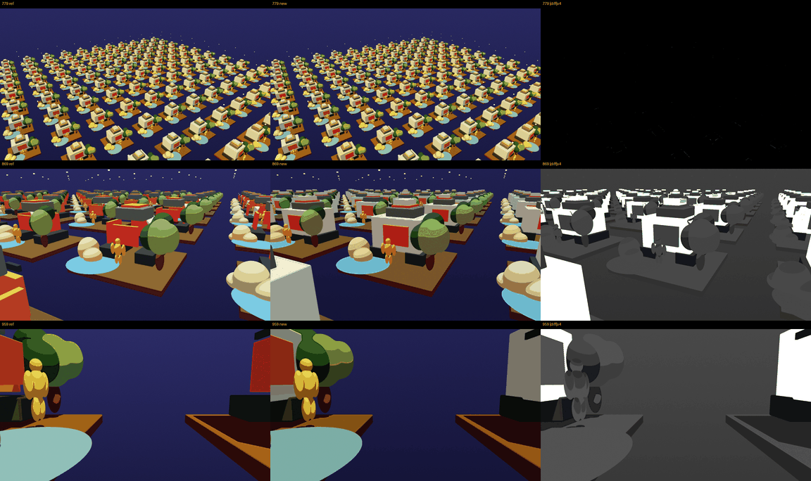
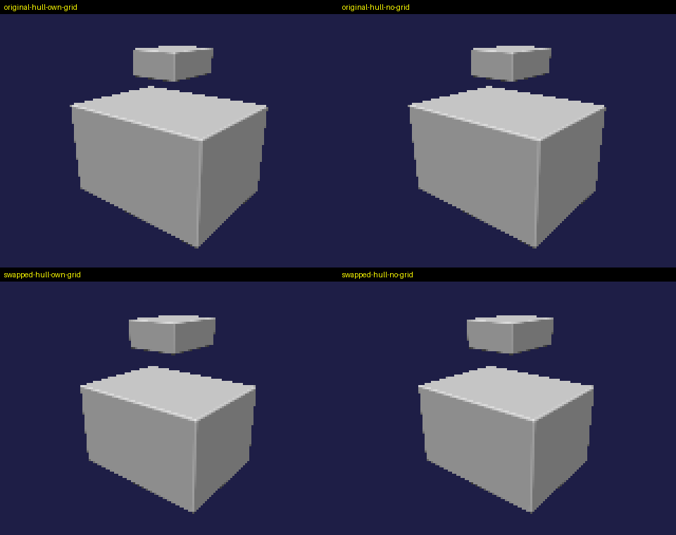

# Load scenario reference (lockstep, 1920x1080)

`reference-hashes.txt` lists the fnv1a64 of the 11 hashed frames of `tools/run-load-scenario.bat`
with `LOAD_SCENARIO_ARGS:--lockstep`, in the `hashes.csv` form the scenario writes
(frame, leg, file, hash). `reference-provenance.json` records where they came from.

The owner approved the re-golden on 2026-11-18. Frames 779, 869 and 959 changed when the occupancy
grid started being published at the procedural shader swap (base-reds 134). The old references
showed the swapped-in hull without its body:

The CPU replay of that hull (`Application.RecipeSwapReplay`) shows a solid box, both with and
without its own occupancy grid:

The full frames are on ws in
`/home/liory/codeman-cases/undertow/reports/opus-rl0-evidence/regold/load-k8-t0`.
