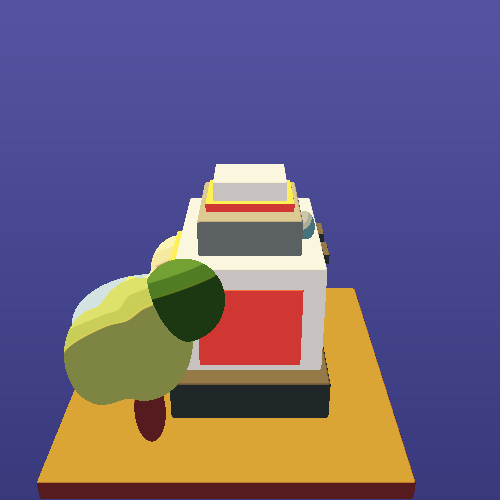

# Stage 1 baseline: midday, 500×500

WSL Dozen correctness capture at **R/D 1.0** with the existing 45° camera and four yaw angles. The focused look-dev CTest repeated these captures in a second fresh process; all four PNG SHA-256 pairs matched exactly. Dozen is used for correctness only, so this sheet provides no performance evidence.

| Yaw 0° | Yaw 90° |
| --- | --- |
|  |  |

| Yaw 180° | Yaw 270° |
| --- | --- |
|  |  |

Visual note: the four views show the vehicle cab, trees, and character against a flat blue background and ochre platform. The cab edges and tree canopies have crisp silhouettes, while broad flat color regions make the cel bands easy to locate. These scale-1 images do not show any reconstruction loss.
